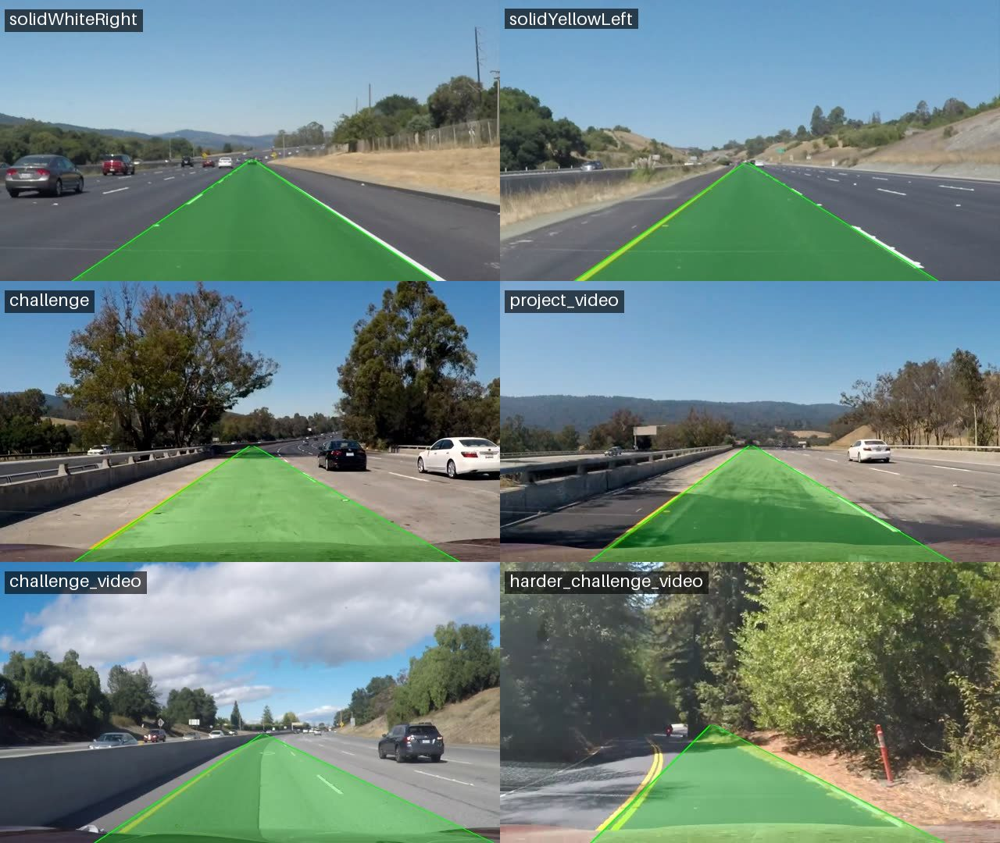
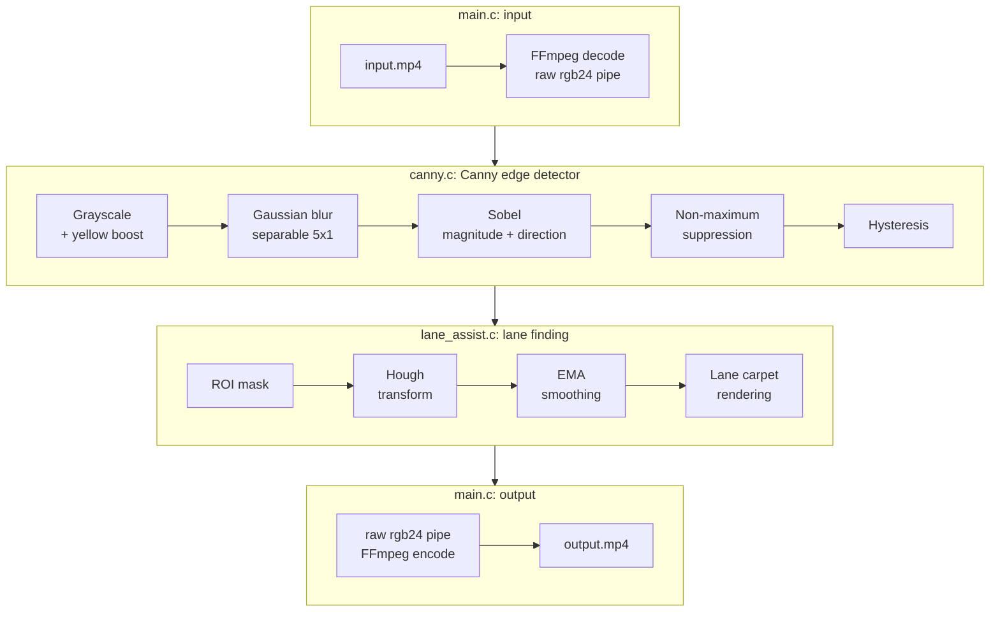

# Real-Time Lane Detection in Pure C


A from-scratch computer vision pipeline that finds road lanes in video, written in plain C with **no OpenCV**.
Every stage (Canny edge detector, region-of-interest mask, Hough transform, temporal smoothing and rendering) is hand-written, parallelized with OpenMP and vectorized with SIMD. Video is streamed through FFmpeg pipes, so frames never touch the disk.

> **~700 FPS** for the vision kernels (1.44 ms per 720p frame) and **10–15× faster than real time** end-to-end on an Apple M2 laptop.
> All 7 benchmark videos (3.4 minutes of footage) finish in **15.7 s**, less than the 25 s that v2 needed for a single 41 s clip.

## Demo

https://github.com/user-attachments/assets/b4244360-0f6b-40fd-9643-c872dc90a973

*Detected lane boundaries with Exponential Moving Average (EMA) smoothing, vanishing-point cutoff and lane-carpet rendering.*

### Standard lane detection test videos



The straight-line model handles highway footage well. On the tight curves of `harder_challenge_video` it breaks down (see [Limitations & Roadmap](#limitations--roadmap)).

---

## Pipeline



1. **Zero-disk video streaming (`main.c`)**: raw `rgb24` frames are read from FFmpeg's `stdout` and written back to a second FFmpeg process for H.264 encoding. A reader thread, the vision code and a writer thread share a ring of 4 frames, so decoding, processing and encoding overlap. Resolution and frame rate are read with `ffprobe`; frames are scaled to 1280 px wide, keeping the aspect ratio.
2. **Color-targeted grayscale (`canny.c`)**: integer luminance (`(306R + 601G + 117B) >> 10`), with yellow lane paint boosted to pure white for contrast on faded asphalt.
3. **Gaussian blur (`canny.c`)**: two 1D binomial passes (`[1 4 6 4 1] >> 4`) instead of a 5×5 matrix, with replicated borders so the frame edge does not create fake edges.
4. **Sobel gradients (`canny.c`)**: integer Sobel sums and a branchless 4-way direction quantization based on slope comparisons instead of `atan2f`.
5. **Non-maximum suppression and hysteresis (`canny.c`)**: thin edges to 1 px, then trace weak edges connected to strong ones with an explicit heap stack, seeded only by strong pixels that touch a weak one. Both stages only run from 32 rows above the ROI down, since everything higher is masked out anyway.
6. **Hough transform and temporal smoothing (`lane_assist.c`)**: votes from pre-computed sin/cos tables, the strongest left and right lines, an 80% / 20% EMA between frames against flicker, and a cutoff where the two lines would cross.

---

## Performance

All numbers come from an **Apple M2 (4 performance + 4 efficiency cores)** on macOS, Apple Clang `-O3 -march=native -ffast-math`, OpenMP with 8 threads.

### Version history (`road.mp4`: 1280×720, 1,232 frames, 41.1 s)

v3 and v4 were measured back to back (median of 3 runs).

| Version | What changed | Wall-clock | Throughput | Real-time factor |
| :--- | :--- | :---: | :---: | :---: |
| v1 | JPEG frames on disk (`stb_image` + FFmpeg extract/encode) | 48.94 s | 25.2 FPS | 0.84× |
| v2 | In-memory FFmpeg `popen()` pipes | 25.18 s | 48.9 FPS | 1.63× |
| v3 | SIMD vectorization, atomic-free Hough, hardware encoder | 5.45 s | 226 FPS | 7.5× |
| **v4** | **Overlapped I/O threads, ROI-only hysteresis, no serial Hough stages** | **3.27 s** | **377 FPS** | **12.6×** |

### Per-stage time (`road.mp4`, ms per frame)

| Stage | v2 | v3 | v4 | v2 → v4 |
| :--- | ---: | ---: | ---: | :---: |
| Grayscale | 0.55 | 0.38 | 0.22 | 2.5× |
| Gaussian blur¹ | 1.01 | 0.11 | 0.15 | 6.7× |
| Sobel magnitude + direction¹ | 2.15 | 0.28 | 0.25 | 8.6× |
| Non-maximum suppression¹ | 1.83 | 0.20 | 0.11 | 16.6× |
| Hysteresis¹ | 1.85 | 1.05 | 0.30 | 6.2× |
| ROI mask | 0.15 | 0.02 | 0.02 | 6.5× |
| Hough transform + rendering | 3.28 | 0.73 | 0.38 | 8.6× |
| **Whole vision pipeline** | **11.48** | **2.75** | **1.44** | **8.0×** |

¹ v2's Canny sub-stages were timed one by one, so its rows do not add up exactly to the total. v3 and v4 come from an instrumented build of the same code.

### Benchmark across 7 videos (v4, median of 3 runs)

| Video | Input | Frames | Length | Vision (ms/frame) | Vision FPS | v2 total | v3 total | v4 total | Real-time |
| :--- | :---: | ---: | ---: | ---: | ---: | ---: | ---: | ---: | :---: |
| `road` | 1280×720 | 1,232 | 41.2 s | 1.71 | 585 | 26.3 s | 5.45 s | 3.27 s | 12.6× |
| `challenge` | 1280×720 | 251 | 10.0 s | 2.32 | 431 | 5.8 s | 1.34 s | 0.98 s | 10.2× |
| `challenge_video` | 1280×720 | 484 | 16.1 s | 1.79 | 559 | 9.3 s | 2.06 s | 1.44 s | 11.2× |
| `harder_challenge_video` | 1280×720 | 1,199 | 48.0 s | 2.26 | 442 | 29.9 s | 5.70 s | 3.36 s | 14.3× |
| `project_video` | 1280×720 | 1,260 | 50.4 s | 2.05 | 488 | 27.5 s | 5.31 s | 3.39 s | 14.9× |
| `solidWhiteRight` | 960×540 | 221 | 8.8 s | 2.20 | 455 | 4.6 s | 1.11 s | 0.82 s | 10.8× |
| `solidYellowLeft` | 960×540 | 681 | 27.2 s | 2.61 | 383 | 14.6 s | 3.01 s | 2.48 s | 11.0× |
| **All** | | **5,328** | **201.7 s** | | | **117.9 s** | **23.97 s** | **15.73 s** | **12.8×** |

Vision times here are measured inside the full program, where FFmpeg decodes and encodes on the same cores at the same time, so they are higher than the isolated 1.44 ms above.

**The program is now encoder-bound.** Piping `road.mp4` through decode → encode with zero vision work already takes 3.2–3.35 s (the VideoToolbox H.264 encoder is the limit), and v4 finishes in 3.27 s. Faster vision code no longer shortens the end-to-end time at 720p.

**Output is unchanged.** Every v4 optimization was checked frame by frame against v3: the drawn output is identical on all 5,328 frames of the 7 videos, and the encoded `road.mp4` decodes to the same frames (infinite PSNR).

### Key optimizations

| Optimization | Baseline | Optimized | Why it is faster |
| :--- | :--- | :--- | :--- |
| **Video I/O** | 1,233 JPEGs extracted to SSD, decoded/encoded per frame with `stb_image` | Direct `fread`/`fwrite` of raw `rgb24` through `popen()` pipes | Removes ~70% of the runtime spent on single-threaded JPEG compression and SSD writes. |
| **Gaussian blur** | 2D 5×5 convolution (25 ops/pixel + float division) | Two 1D 5×1 passes (10 ops/pixel + integer `>> 4`) | 2.5× fewer memory reads and multiplications, and a bit-shift instead of a float division. |
| **Edge direction** | `atan2f(gy, gx) * 180 / π` per pixel | Slope comparisons (`\|gy\| <= 0.4142 * \|gx\|`) chosen without branches | No transcendental functions, and the loop stays vectorizable. |
| **SIMD vectorization** | `collapse(2)` loops without `restrict` and with `switch`/`if` chains: the compiler vectorized none of them | One row per thread, `restrict` row pointers, `#pragma omp simd`, branchless selection | Grayscale, blur, Sobel, NMS and hysteresis cleanup process 16 pixels per NEON instruction (verified with `-Rpass=loop-vectorize`). |
| **NMS normalization** | Separate pass dividing the whole float image by `max_mag` | Multiplication by `255 / max_mag` fused into the NMS pass | Saves a full read and write of a 3.7 MB buffer per frame. |
| **Hysteresis** | Single-threaded strong/weak classification | Rows classified in parallel, each row writing its seeds into its own slice of the stack | Only the edge-tracing flood fill stays serial. |
| **Hough trigonometry** | `cosf`/`sinf` per edge pixel and angle | 180-entry lookup tables computed once | Millions of trig calls per frame become L1-cache lookups. |
| **Hough voting** | `#pragma omp atomic` on every vote, all threads on the same accumulator | Edge pixels collected once; each thread owns whole θ rows of a θ-major accumulator | No atomics and no cache-line ping-pong between cores. |
| **ROI mask** | Two float comparisons per pixel | Bounds converted to pixel indices once per row, outside parts cleared with `memset` | Turns a per-pixel loop into two memory clears per row. |
| **Memory management** | `malloc`/`free` inside the per-frame loop | Persistent buffers, zeroed once with `calloc` and overwritten every frame | No heap traffic and no per-frame clearing. |
| **Overlapped I/O** | Read a frame, process it, write it, then read the next one | Reader and writer threads share a 4-frame ring with the vision code | Decoding, vision and encoding run at the same time; `road.mp4` now finishes at the speed of the hardware encoder. |
| **Grayscale loads** | Channel stride known only at runtime: the compiler emits 51 single-byte loads per 16 pixels | Constant stride of 3, so the compiler uses NEON `ld3` (load and split 16 RGB pixels in one instruction) | 1.7× faster grayscale in portable C, no intrinsics or assembly. |
| **ROI-only hysteresis** | NMS and hysteresis over the whole frame, including trees and sky that the ROI throws away | Both start 32 rows above the ROI; the max gradient for normalization still comes from the full frame | Most of the textured background is skipped; lane output is identical on all test videos. |
| **Hysteresis seeds** | Every strong pixel is pushed onto the stack | Only strong pixels that touch a weak pixel become seeds | The single-threaded flood fill drops from 0.65 to 0.10 ms per frame. |
| **Serial Hough stages** | Edge collection, peak search and accumulator clearing on one thread | Rows collect edges in parallel; each thread searches and clears its own θ rows right after voting, with ρ computed 256 at a time (SIMD) | Removes ~0.4 ms of single-threaded work per frame. |
| **OpenMP scheduling** | Rows split evenly between threads | `schedule(dynamic, 8)` | The M2's 4 efficiency cores no longer hold back its 4 performance cores. |
| **Video encoding** | `libx264` on the default preset (the real bottleneck of v2) | `h264_videotoolbox` hardware encoder on macOS, `libx264 -preset veryfast` elsewhere | Gives the CPU cores back to the vision kernels. |

---

## Getting Started

### Requirements

* **macOS** with Apple Clang, or **Linux** with `gcc` (on Windows, use **WSL2**)
* **OpenMP**: `brew install libomp` on macOS (included with `gcc` on Linux)
* **FFmpeg** with `ffprobe`: `brew install ffmpeg` on macOS, `sudo apt install ffmpeg` on Debian/Ubuntu

### Run on a video

```bash
git clone https://github.com/NikitaSch2004/LaneDetector.git
cd LaneDetector
./run_line_detector.sh input.mp4 output.mp4
```

Without arguments it reads `road.mp4` and writes `processed_road.mp4`. Any resolution and frame rate is accepted, and the program prints the average vision time per frame when it finishes.

### Run the benchmark

Download the standard test videos (about 83 MB):

```bash
for v in solidWhiteRight solidYellowLeft challenge; do
  mkdir -p test_videos/$v
  curl -L -o test_videos/$v/$v.mp4 https://raw.githubusercontent.com/udacity/CarND-LaneLines-P1/master/test_videos/$v.mp4
done
for v in project_video challenge_video harder_challenge_video; do
  mkdir -p test_videos/$v
  curl -L -o test_videos/$v/$v.mp4 https://raw.githubusercontent.com/udacity/CarND-Advanced-Lane-Lines/master/$v.mp4
done
```

Then run every video 3 times and print the results table (processed videos go to `benchmark_output/`):

```bash
./benchmark.sh
RUNS=5 ./benchmark.sh
```

---

## Project Structure

```
├── main.c                 FFmpeg pipes, reader/writer threads, frame loop, timing
├── canny.c / canny.h      grayscale, Gaussian blur, Sobel, NMS, hysteresis
├── lane_assist.c / .h     ROI mask, Hough transform, EMA smoothing, rendering
├── build.sh               compiler flags for macOS (clang + libomp) and Linux (gcc)
├── run_line_detector.sh   build, process one video and open the result
├── benchmark.sh           build, process every test video N times and print a results table
└── assets/                README images
```

Older, slower versions of each optimized kernel are kept as commented-out `SLOWER WAY` blocks next to the `FASTER WAY` code, so the before/after of every optimization can be read in place.

---

## Limitations & Roadmap

- [ ] **Curved roads**: the Hough transform fits one straight line per side, so on the tight curves of `harder_challenge_video` the lane carpet leaves the road. Next step: bird's-eye perspective warp, sliding windows and a second-order polynomial fit.
- [ ] **Outlier rejection**: on `challenge_video` the right boundary sometimes misses the low-contrast dashed marking. Reject large jumps before the EMA and weight the blend by vote count.
- [ ] **Lost lanes**: when a side is not detected, the last line stays on screen forever; it should fade out after N frames.
- [ ] **Library-friendly API**: replace the function-level `static` state with a context struct (`create` / `process` / `destroy`) to support multiple streams and unit tests.

---

## Acknowledgements

The benchmark videos come from Udacity's [CarND-LaneLines-P1](https://github.com/udacity/CarND-LaneLines-P1) and [CarND-Advanced-Lane-Lines](https://github.com/udacity/CarND-Advanced-Lane-Lines) repositories (MIT License). They are not included in this repository.
